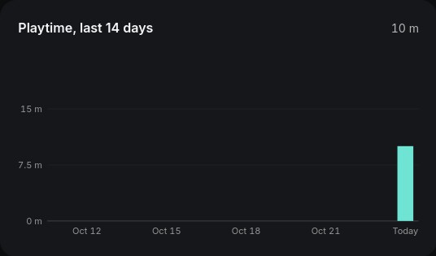
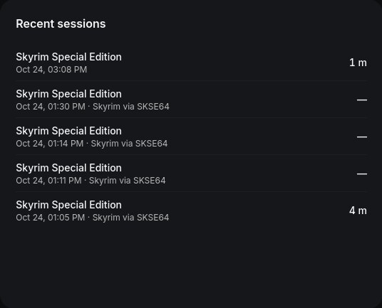

<p align="center"></p>

# Respawn+ Launcher

**Run, play and configure Windows games and their mods on Linux, the way you would on Windows.**

Respawn+ is a general, open-source launcher. Each game gets its own Proton or Wine environment (a "room"), and any mod manager (Mod Organizer 2, Vortex or another), script extender or trainer (standalone, or apps like WeMod) can be added to it as a companion app and run alongside the game. They share one container, so they see the same files and the same Windows processes, just as on Windows.

**Status: v0.1.0 Beta, coming soon.** Builds from source today; Lite RPM and DEB packages arrive with v0.1.0. Licensed under **MIT**; see [LICENSE](LICENSE), [NOTICE](NOTICE) and [third-party notices](THIRD_PARTY_NOTICES.md). Website: `website/` (Cloudflare Pages project `respawnplus`).

<p>
  
  
</p>

## What it does today

- **Finds your games.** Scans folders for Windows games or imports any `.exe`. Nothing is copied or changed.
- **One room per game.** An isolated Wine prefix with Proton through [UMU](https://github.com/Open-Wine-Components/umu-launcher), plain Wine, or a runner you choose.
- **Any mod manager, script extender or trainer.** Add it to a game as a companion app; it inherits the game's runner and prefix and joins the game's container while the game runs (UMU `UMU_CONTAINER_NSENTER`).
- **Display modes.** Fullscreen, borderless or windowed at your resolution, for any game: Respawn+ sets the room's own screen and never edits the game's files.
- **Playtime and sessions.** Every session timed, daily totals for 14 days, last played. Launches through a script extender count as play.
- **Launch logs.** A separate log per game and companion launch. Proton's shared log is not used, so a companion app can no longer overwrite the game's crash output.
- **Room recovery.** Automatic setup checkpoints and restore with current mapped saves preserved, initially for Skyrim SE and Fallout 4. Btrfs snapshots where available, reflinks or copies elsewhere; see [support and limits](docs/room-recovery.md).
- **Runtime discovery.** UMU, system Wine, native and Flatpak Steam Proton, Lutris Wine, and folders in `RESPAWN_RUNTIME_DIRS`.
- **A desktop app.** Home dashboard, library with filters, a page per game, light and dark themes, built-in window controls. Your library is a local SQLite file.

## Modding: what is verified and what is next

Verified on Fedora with GE-Proton 11-11, UMU 1.4.4 and Skyrim Special Edition 1.7.104:

- The game, its script extender (SKSE 2.3.1) and a standalone trainer ran together in one room; the trainer found `SkyrimSE.exe` (process 400) and all of its options ran without a crash.
- Mod Organizer 2.5.2 ran under Proton in the game's prefix: its own window, its virtual filesystem, and Skyrim started from MO2's Run button with a trainer alongside.

**Play through any companion app.** On a game's Launch tab, *Play starts* can be the game itself or any of its companion apps, for example Mod Organizer 2 with the argument `moshortcut://:SKSE`, or Vortex. Play then opens that app in the game's room and the session counts as play; opening the manager on its own does not. Every other companion (trainers, WeMod, tools) still runs alongside.

Next: one-click setup helpers for common managers (see [the design](docs/superpowers/specs/2026-10-24-mod-manager-integration-design.md)).

Compatibility varies by game and tool; Respawn+ says what was tested and does not promise universal Windows parity. Games and companions now run inside a shared bubblewrap room, with a private home, process namespace and display. See [room security and runtime support](docs/proton-rooms.md) for the current boundary and limitations.

## Repository layout

This is an npm-workspaces monorepo.

| Path | What it is |
| --- | --- |
| `src/`, `index.html` | Launcher frontend (Vite, vanilla JS) |
| `src-tauri/` | Launcher backend (Rust, Tauri v2, SQLite) |
| `docs/` | User and developer documentation, also published on the website |
| `website/` | Website: landing page, docs, about, downloads (Astro, static) |
| `packaging/`, `scripts/` | Lite/Full packaging, runtime installer, brand and test helpers |

## Develop

Prerequisites: Rust stable, Node.js 22.12+ and npm, the [Tauri Linux dependencies](https://v2.tauri.app/start/prerequisites/), and Proton (via UMU) and/or Wine.

```bash
npm ci
npm run tauri dev                 # run the launcher
npm run site:dev                  # run the website at http://localhost:4321
```

Builds:

```bash
npm run bundle:lite               # Lite RPM and DEB (uses your own runtimes)
npm run bundle:full               # Full packages, after staging the runtime bundle
npm run bundle:lite -- --no-bundle --debug   # just the executable
npm run site:build                # static website in website/dist/
scripts/install-desktop-entry.sh  # menu entry and taskbar icon for a local build
```

The website deploys to Cloudflare Pages as project `respawnplus` (`website/wrangler.toml`): `cd website && npx wrangler pages deploy`.

## Verify

```bash
npm run doctor
npm run check
npm run build
npm run test:packaging
cargo test --manifest-path src-tauri/Cargo.toml
cargo clippy --manifest-path src-tauri/Cargo.toml --all-targets -- -D warnings
cargo run --manifest-path src-tauri/Cargo.toml -- --diagnose
```

`--diagnose` initialises the local SQLite database and prints the detected runtimes without opening a window. Tests use temporary databases and never touch your game state.

## Fedora host setup

Tauri build dependencies, from the [official prerequisites](https://v2.tauri.app/start/prerequisites/):

```bash
sudo dnf install webkit2gtk4.1-devel openssl-devel curl wget file \
  libappindicator-gtk3-devel librsvg2-devel libxdo-devel gcc gcc-c++ make
```

Wine and 32-bit graphics support (AMD example):

```bash
sudo dnf install wine winetricks mesa-vulkan-drivers.i686 vulkan-loader.i686
vulkaninfo --summary
```

For non-Steam games, use UMU with GE-Proton or UMU-Proton; Steam is not required. `npm run setup:runtime` installs the official UMU 1.4.4 zipapp with a pinned checksum under `~/.local/share/respawn-plus/tools/umu/1.4.4`, linked from `~/.local/bin/umu-run` (Python 3.10+; existing installations are kept). No third-party binaries are checked into this repository.

UMU downloads Proton and the Steam Linux Runtime on first run. To initialise a test prefix without starting a game:

```bash
WINEPREFIX="$HOME/.local/share/respawn-plus/prefixes/runtime-check" \
  GAMEID=0 PROTONPATH=GE-Proton umu-run cmd.exe /c 'exit 0'
```

## Data locations

- Library: `$XDG_DATA_HOME/respawn-plus/respawn-plus.sqlite3` (normally `~/.local/share/respawn-plus/`), schema v5.
- Prefixes: `~/.local/share/respawn-plus/prefixes/game-<id>`.
- Launch logs: `~/.local/state/respawn-plus/logs/library/`.

## Documentation

[Your library](docs/library.md) · [Mods and trainers](docs/companion-apps.md) · [First test game](docs/test-game.md) · [Distribution](docs/distribution.md) · [Verified environment](docs/environment.md) · [Contributing](CONTRIBUTING.md)
